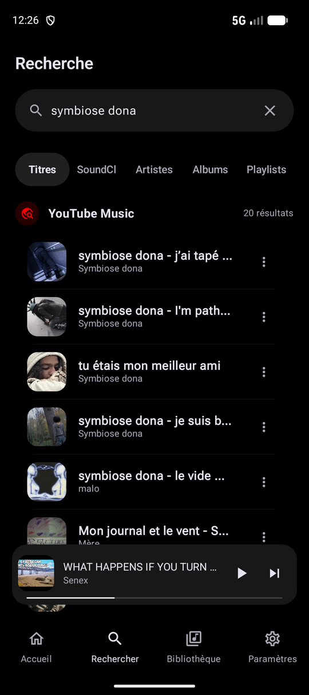
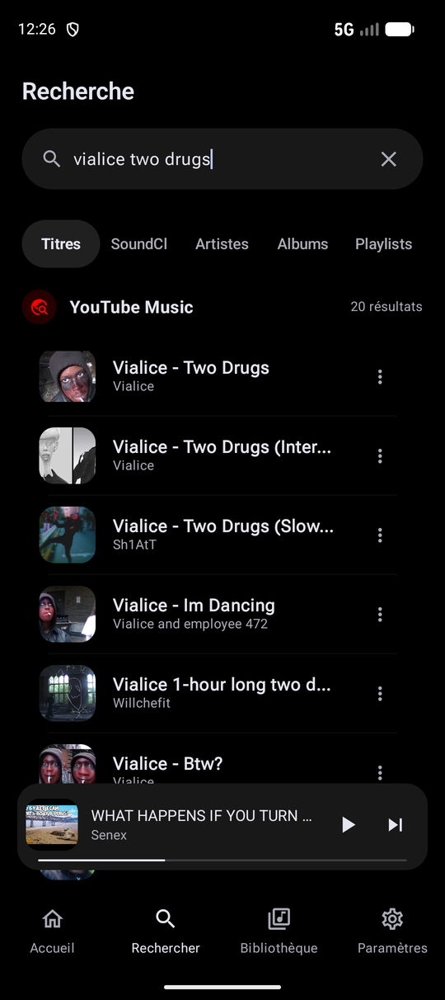
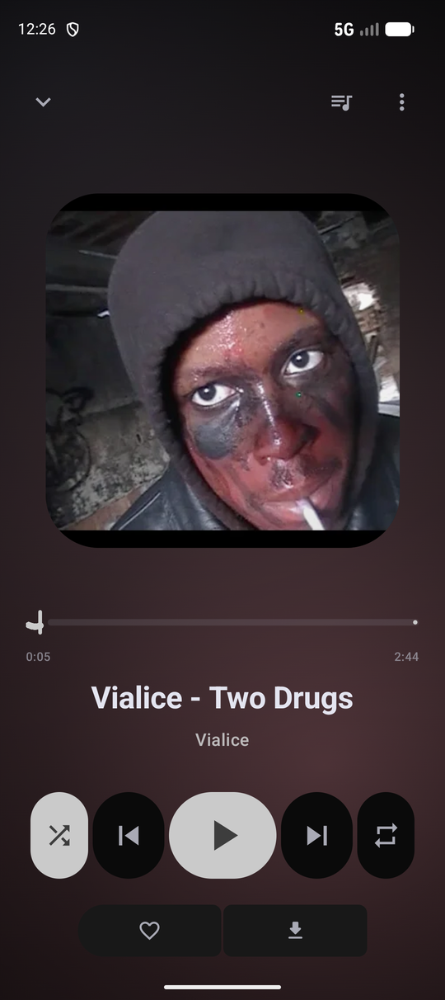

# Triat for Android

a music player for youtube. no ads, no account needed, no api key.

search a song, see its cover, play it. that's most of it.

<p align="center">
  
  
  
</p>

Every result in the search comes with its artwork, so you can tell the
original from the slowed edit from the one-hour loop before you tap. The two
searches above are just two tracks I had on repeat while writing this:
*symbiose dona - je suis bloqué au milieu d'un k-hole* and
*Vialice - Two Drugs*.

## what it does

- Search songs, artists, albums and playlists, on YouTube Music or SoundCloud
- Plays in the background, with a queue, shuffle and repeat
- Skips the non-music parts (intros, talking, sponsor reads) with SponsorBlock
- Finds new music by following the artists you already listen to, and tells
  you where each suggestion came from
- Playlists, likes, listening history, and offline downloads
- Import a plain text list of songs into a playlist
- Syncs with [Triat on desktop](https://github.com/kerstz/triat) over your Wi-Fi,
  no cloud in between
- Dark, quiet interface, in French and English

## sync with the desktop app

Playlists, likes and history stay the same on the phone and on the computer.
Pair once, either with the short code or by scanning the QR code shown by
the desktop app (Settings, Synchronisation, Pair a phone). After that the
phone syncs by itself whenever it is on the same Wi-Fi. Everything is
encrypted, and your YouTube session is only shared if you allow it on both
sides.

## based on Koda

Triat is a fork of [Koda](https://github.com/Ivorisnoob/Koda) by Ivorisnoob.
The player, most of the interface and the YouTube code come from there.
Thank you to Ivorisnoob and to everyone who worked on it.

What is different here:

- new name, new icon, a quieter dark palette
- French translation of the whole app
- SoundCloud as a second source
- discovery through an artist graph instead of keyword searches
- SponsorBlock tuned for music
- Wi-Fi sync with the desktop app, with QR pairing
- much less on screen: fewer buttons, fewer shelves, fewer settings in your face

The Kotlin package is still called `com.ivor.ivormusic`, on purpose, so it
stays easy to follow Koda's changes.

## a word of warning

A large part of this code was written with an AI. I did not read every line.
I use the app daily on my own phone and fix what breaks. Expect rough edges,
and expect things to break when YouTube changes something. Bug reports are
welcome.

## build it

You need a recent Android Studio, and a device or emulator on Android 11 or
newer.

```bash
git clone https://github.com/kerstz/triat-android.git
cd triat-android
./gradlew assembleDebug
```

The APK ends up in `app/build/outputs/apk/debug/`. The `docs/` folder and
[CLAUDE.md](CLAUDE.md) explain how the code is organised.

## license

Free software under the [GNU General Public License v3.0](LICENSE), the same
as Koda. If you share a modified version, it has to stay under the same
license and its source has to be available.

Koda is Copyright 2026 Ivorisnoob. Triat additions are by kerstz.
