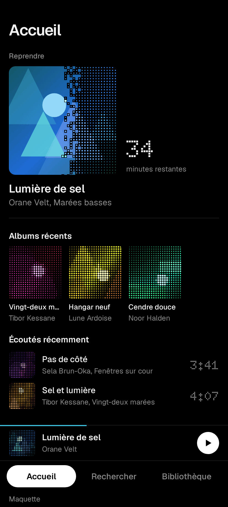
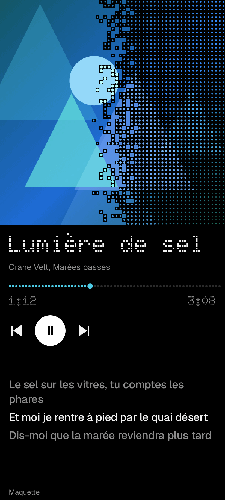
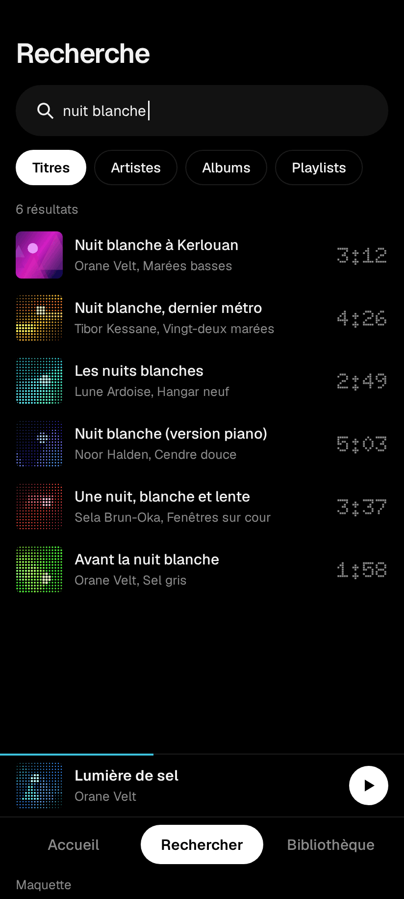

<p align="center">
  
</p>

<h1 align="center">Triat pour Android</h1>

<p align="center">
  <a href="../README.md">English</a> | Français
</p>

<p align="center">
  Un lecteur de musique pour YouTube. Pas de compte, pas de clé d'API, pas de statistiques d'usage.
</p>

<p align="center">
  <a href="../LICENSE"></a>
  
  <a href="https://github.com/kerstz/triat"></a>
  <a href="https://kerstz.github.io/triat/"></a>
</p>

<p align="center">
  
  
  
</p>

Maquettes, pas des captures : ces images suivent la direction de design et utilisent du contenu fictif.

Triat pour Android a un [site](https://kerstz.github.io/triat/), et un pendant pour ordinateur, [Triat pour Linux](https://github.com/kerstz/triat).

## Ce que ça fait

- Cherche des titres, artistes, albums et playlists sur YouTube Music
- Seconde source optionnelle : SoundCloud. Tu peux la désactiver dans Réglages, voir l'avis juridique
- Lecture en arrière-plan avec une file d'attente, la lecture aléatoire et la répétition
- SponsorBlock : saute les intros, les passages parlés et les placements de sponsors (à activer dans Réglages)
- Découverte à partir des artistes que tu écoutes déjà, avec la source de chaque suggestion
- Playlists, j'aime, historique d'écoute et téléchargements pour écouter hors ligne (voir l'avis juridique)
- Importe une liste de titres ou de liens YouTube en texte brut dans une playlist
- Synchro Wi-Fi avec [Triat sur ordinateur](https://github.com/kerstz/triat), sans cloud
- Scrobbling Last.fm en option
- Disponible en français, en anglais et dans beaucoup d'autres langues

## Vie privée

Aucun compte n'est nécessaire, et l'application n'a ni statistiques d'usage, ni télémétrie, ni rapport de plantage à distance. Un plantage est enregistré sur le téléphone, et c'est toi qui décides de l'envoyer ou non.

Les hôtes que l'application contacte, selon ce que tu utilises :

| Hôte | Pourquoi |
|---|---|
| `youtube.com`, `music.youtube.com`, `youtubei.googleapis.com`, `i.ytimg.com` | Recherche, lecture, pochettes |
| `sponsor.ajay.app` | Segments SponsorBlock, si activé |
| `soundcloud.com` | La seconde source optionnelle |
| `api.github.com` | Chercher une version plus récente |
| `noembed.com` | Retrouver un titre quand YouTube n'en donne pas |
| `music.apple.com`, `amp-api-edge.music.apple.com` | Pochettes animées, désactivées par défaut |
| `ws.audioscrobbler.com`, `last.fm` | Last.fm, seulement si tu le connectes |
| `accounts.google.com` | Connexion à YouTube Music, seulement si tu choisis de te connecter (une vue web, rien n'est stocké hors de l'app) |
| Ton ordinateur, sur ton réseau local | Synchro, seulement si tu appaires |

## Installation

Télécharge l'APK depuis la page [Releases](https://github.com/kerstz/triat-android/releases) et ouvre-le sur ton téléphone. Sur un téléphone récent, prends celui en `arm64-v8a`. Android 11 ou plus récent est requis.

Sommes SHA-256 : elles arrivent avec la prochaine version. D'ici là, n'installe qu'un APK venant de cette page.

## Synchro avec l'application de bureau

Les playlists, les j'aime et l'historique restent identiques sur le téléphone et sur l'ordinateur. Appaire une fois, avec le code court ou en scannant le QR code affiché dans l'application de bureau (Réglages, Synchronisation, Appairer un téléphone). Ensuite, le téléphone se synchronise tout seul dès qu'il est sur le même Wi-Fi. Tout est chiffré, et ta session YouTube n'est partagée que si tu l'autorises des deux côtés.

Le protocole est décrit dans [sync.md](sync.md) (en anglais).

## Basé sur Koda

Triat est un fork de [Koda](https://github.com/Ivorisnoob/Koda) par Ivorisnoob. Le lecteur, l'essentiel de l'interface et le code YouTube viennent de là. Merci à Ivorisnoob et à tous ceux qui y ont travaillé.

Ce qui change ici :

- Nouveau nom, nouvelle icône, une palette sombre plus calme
- Toute l'application traduite en français
- SoundCloud comme seconde source
- Découverte par un graphe d'artistes plutôt que par des recherches de mots-clés
- SponsorBlock réglé pour la musique
- Synchro Wi-Fi avec l'application de bureau, avec appairage par QR code
- Moins de choses à l'écran : moins de boutons, moins de rayons, moins de réglages

Le paquet Kotlin s'appelle toujours `com.ivor.ivormusic`, volontairement, pour suivre facilement les changements de Koda.

## Fait avec une IA

L'essentiel de ce code a été écrit avec une IA (Claude), et je n'ai pas relu chaque ligne. Je ne suis pas développeur. J'utilise l'application tous les jours sur mon propre téléphone et je corrige ce qui casse. Attends-toi à des aspérités, et à des pannes quand YouTube change quelque chose. Les rapports de bugs sont les bienvenus.

## La compiler

Il te faut un Android Studio récent et un appareil ou un émulateur sous Android 11 ou plus récent.

```bash
git clone https://github.com/kerstz/triat-android.git
cd triat-android
./gradlew assembleDebug
```

L'APK est écrit dans `app/build/outputs/apk/debug/`. Pour une version de publication signée, voir [build-apk.md](build-apk.md). Le dossier `docs/` et [CLAUDE.md](../CLAUDE.md) expliquent l'organisation du code.

## Avis juridique

Triat pour Android est un projet personnel indépendant. Il n'est **ni affilié, ni approuvé, ni sponsorisé par Google LLC, YouTube, YouTube Music ou SoundCloud**. YouTube est une marque de Google LLC, SoundCloud de SoundCloud Global Limited & Co. KG.

L'application n'héberge ni ne distribue aucune musique. Elle lit ce que tu choisis d'ouvrir depuis des services publics. Tu es responsable de l'utiliser conformément aux conditions de ces services et au droit d'auteur du pays où tu vis. SoundCloud est une seconde source optionnelle que tu peux désactiver dans Réglages. Ses conditions peuvent ne pas autoriser ce type d'usage : vérifie-les avant de la garder active.

Les conditions d'utilisation de YouTube n'autorisent pas le téléchargement de contenu, sauf si YouTube propose une option de téléchargement pour ce contenu. N'utilise la fonction de téléchargement que pour du contenu que tu as le droit de conserver.

Cet avis n'est pas un avis juridique.

## Contribuer, sécurité et conduite

Ces fichiers sont en anglais.

- [CONTRIBUTING.md](../CONTRIBUTING.md) : les pull requests externes sont en pause pour le moment, les rapports de bugs et les idées sont les bienvenus
- [SECURITY.md](../SECURITY.md) : signale les failles en privé
- [CODE_OF_CONDUCT.md](../CODE_OF_CONDUCT.md)

## Crédits

- [Koda](https://github.com/Ivorisnoob/Koda) par Ivorisnoob (GPL-3.0), voir plus haut.
- [SponsorBlock](https://sponsor.ajay.app) : les données de segments sont récupérées à l'exécution depuis l'API SponsorBlock et sous licence [CC BY-NC-SA 4.0](https://creativecommons.org/licenses/by-nc-sa/4.0/). L'application ne les redistribue pas.
- [Last.fm](https://www.last.fm) : scrobbling optionnel.

## Licence

Logiciel libre sous [licence publique générale GNU v3.0](../LICENSE), comme Koda. Si tu partages une version modifiée, elle doit rester sous la même licence et son code source doit être disponible.

Koda est Copyright 2026 Ivorisnoob. Les ajouts de Triat sont de kerstz.
